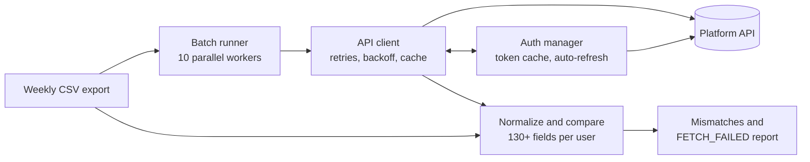

# Data Parity Checker

**A QA automation tool that proves a data export matches what users see in the product.**

A weekly reporting CSV and the live dashboard are fed from different paths. If they drift apart, stakeholders make decisions on numbers users never saw. This tool compares them automatically, user by user, and reports every disagreement.

> **About this repo:** This is a sanitized copy of a tool I built and used on a real project, where it helped validate a data dictionary: the agreed definition of each exported field, checked against what the product actually serves. To share it publicly, I removed client names, hosts, endpoints, credentials and all user data, and replaced them with placeholders and synthetic values. The logic and structure are unchanged. The tool will not run against a live system until you plug in your own API.

```
CSV export ────┐
               ├──► compare 130+ fields per user ──► report mismatches
Platform API ──┘
```

## The problem

- Manual spot-checking of weekly exports covers a handful of users and misses regressions.
- Each user has 60+ metrics (vitals, labs, activity, survey answers) coming from separate API endpoints, so a bug in one endpoint can hide behind correct values elsewhere.
- The API needs short-lived tokens from a two-step login, and the batch must run in parallel to finish in reasonable time.

## What I built

A Python batch runner that, for every user in the CSV:

1. Authenticates through a thread-safe token manager.
2. Fetches all metrics from the API, with retries and caching.
3. Normalizes both sides (numbers, dates, casing, comma-separated lists), so formatting differences aren't reported as bugs.
4. Prints each real mismatch with the user, field, CSV value and dashboard value.

It runs 10 users in parallel by default and is designed to run against each new weekly export.

**In practice:** a weekly export covered roughly 290–300 users, a number that grew as more users were onboarded. A full run, checking every user across 130+ fields, took about 10 minutes. The number of mismatches varied from week to week, from very few to many, which is why every user gets checked every time.

## How it works



## Try it in seconds

`demo.py` needs no credentials or real API. It starts a mock API on localhost and runs the real auth manager and API client against it for the 12 users in `sample_data/demo_snapshot.csv`. The mock expires tokens mid-run, rejects one token, returns a transient 503, and has one endpoint that never recovers. Three values in the CSV are deliberately wrong.

Requires Python 3.9+ and about 10 seconds:

```bash
git clone https://github.com/ShwacchaJitu/data-parity-checker.git
cd data-parity-checker
python -m venv .venv
source .venv/bin/activate        # Windows: .venv\Scripts\activate
pip install -r requirements.txt
python demo.py
```

Expected output (about 7 seconds):

```
🔑 Token refreshed (profile 1), valid for 0 minutes.
↻ Retry 1/4 for RHR_dashboard (HTTP 503)
↻ Retry 1/4 for ldl_dashboard (HTTP 403 (token rejected))
⚠️  Mismatch → user_id 100000004 | CSV wellness_clinical: 65 | Dashboard wellness_clinical: 64
🚫 FETCH_FAILED → user_id 100000007 | hrv | not compared (hrv_val_dashboard failed after 5 attempts (HTTP 503))
⚠️  Mismatch → user_id 100000009 | CSV clinic: Example Clinic Z | Dashboard clinic: Example Clinic B
⚠️  Mismatch → user_id 100000011 | CSV rhr: 69 | Dashboard rhr: 66

Checked 12 users in 6.7s | 3 mismatches | 1 fetch failures (not compared)
```

The demo asserts that exactly the planted problems are reported, so it also works as a smoke test. It compares 5 fields, where the real batch scripts compare 130+, and it shortens token lifetimes and retry waits so it finishes quickly.

## Long runs without manual re-login

A full batch can run for many minutes, longer than one API token lives. Given the credentials in `.env`, the tool handles this itself:

- **It logs in once and caches the token per credential profile.**
- **It renews the token before it expires.** The token's expiry is read from the token itself, and a new login happens about 5 minutes early. If the expiry can't be read, it assumes 25 minutes.
- **It checks the token on every request,** not once per session. A request that starts late in a run never carries a stale token.
- **If the server rejects a token anyway** (revoked or clock skew), the cached token is dropped, the tool logs in again and retries the request.
- **Parallel workers share one login.** When the token expires, only one worker refreshes it and the others wait and reuse the new one.

The result is that a validation run finishes without anyone supplying a new token mid-way.

## Engineering decisions worth noting

| Decision | Why |
|---|---|
| **`FETCH_FAILED` sentinel** | A metric whose API call failed is marked `FETCH_FAILED` (with the reason recorded per field) instead of being compared as if the dashboard held no value. The sentinel compares equal to everything, so a comparison that slips through unguarded reports "no mismatch" rather than inventing one. A flaky endpoint can't create false alarms. |
| **Token manager with lock, early refresh and `invalidate()`** | Parallel workers would otherwise all log in at once when a token expires. Only the first refreshes, and the rest reuse the new token. A rejected token is only cleared if it is still the cached one, which avoids workers wiping each other's fresh tokens. |
| **30 s login cooldown** | After a failed login the client stops retrying. If the cause was a lockout or throttle, retrying would keep it locked. |
| **Retry policy: up to 6 attempts, exponential backoff (~31 s total) with jitter** | Retries on timeouts, 408/425/429, any 5xx (including CDN 52x errors) and on a 200 with an unparseable body, such as a gateway error page, which would otherwise look like "no data". After the last attempt it raises instead of returning blanks. A 403 for an unauthorized account fails immediately, since retrying can't help, and any other 4xx means "no such record". Jitter stops workers from retrying in lockstep. |
| **Per-run request cache** | Shared endpoints are called once per run instead of once per user. |
| **Auth stamped per request (`BearerAuth`)** | A long-lived session would otherwise keep sending the token it started with, long after it expired. |
| **Secrets only in `.env`; real data git-ignored** | Nothing sensitive can be committed by accident. |

## Verification

`test_api_request.py` is a dependency-free self-check of the retry rules. It covers:

- a 200 with invalid JSON retries, then fails loudly if it never recovers
- a 503 recovers after a blip
- a CDN 520 retries
- a plain 404 returns `{}` without retrying

```bash
python test_api_request.py   # all api_request checks passed
```

## Run it

Python 3.9+. Real runs need API access.

```bash
pip install -r requirements.txt
cp .env.example .env     # fill in credentials (git-ignored)
# set startDate / endDate / base_url in global_data.py
python batch_parity_check.py weekly_snapshot.csv      # [csv_path] [credential_profile]
```

Mismatches print like this:

```
⚠️  Mismatch → user_id 100000001 | CSV wellness_clinical: 67 | Dashboard wellness_clinical: 68
```

On Windows, set `PYTHONIOENCODING=utf-8` for the emoji output.

### Running more batch checks with more profiles

The tool ships with one credential profile (`1`). Each profile is one account, with its own cached token, so you can run separate parity checks, such as another account or another export, without changing any logic:

1. Add the account's credentials to `.env` as `LOGIN_USERNAME_2` and `LOGIN_PASSWORD_2`.
2. Add a `"2"` entry to `_PROFILES` in `auth_manager.py`, copying the `"1"` entry. The token cache is created from that dict automatically.
3. Run the check with the profile as the second argument:

```bash
python batch_parity_check.py other_snapshot.csv 2
```

## Layout

```
batch_parity_check.py                       batch runner: compare every CSV row with the API (credential profile 1 by default)
api_client.py                                API client: 60+ metrics per user, retries, cache
auth_manager.py                             token cache, refresh, cooldown, BearerAuth
data_prinf.py                               debug: print every metric for one user
test_api_request.py                         retry-logic self-check
demo.py                                     runnable demo against a mock API (no credentials)
sample_data/                                synthetic CSV for the demo
```

## Data and privacy

No real credentials, hosts or user data are in this repo. Placeholders (`api.example.com`, `100000001`) stand in for them. Real CSVs and run outputs are git-ignored, and `sample_data/` is synthetic.

## What I'd do next

- Move the 130+ field comparisons out of one long function into a table of field mappings.
- Write mismatches to a CSV or HTML report instead of printing them.
- Run on a schedule in CI and alert on a non-zero mismatch count.
